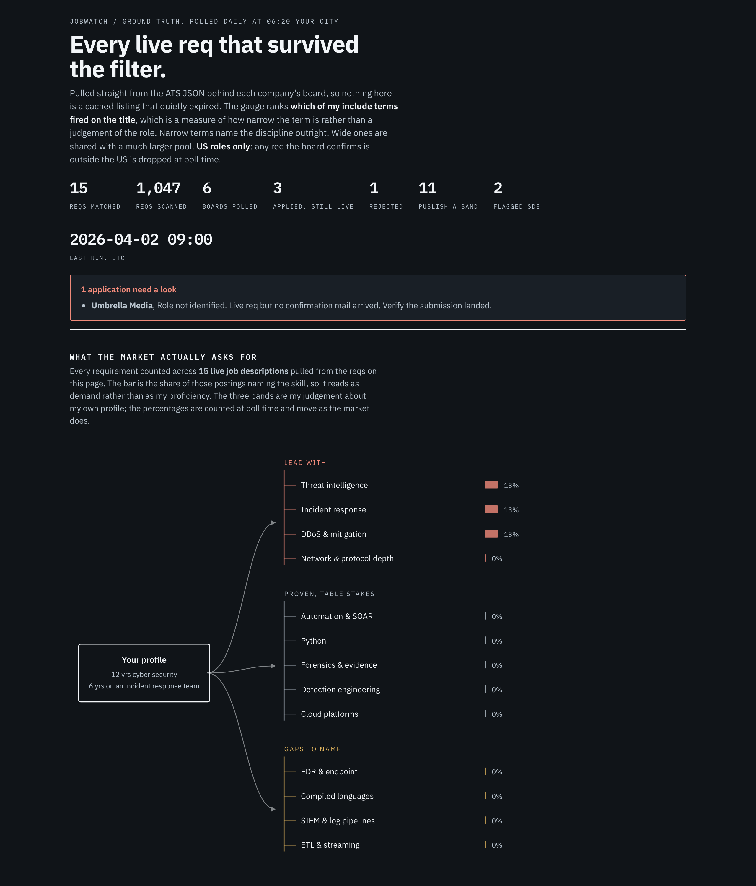

# jobwatch

A single-file poller that reads company job boards through the JSON APIs their applicant tracking
systems actually serve, then diffs today against yesterday and tells you what opened and what closed.

I built it because I was scouring LinkedIn by hand, which was the only place I knew to look, and it
is a bad instrument for this. It surfaces what its ranking feels like surfacing, it buries reqs that
never used the words I search for, and it is always a little behind the company's own board. Job req
URLs also rot within weeks. In one week I lost two roles that way, both still looking live in every
cached view I could find and both already closed.

So the first goal was simply **every relevant req in one place, from the source, with a diff**.

The second goal is the one this is really building toward: an **agentic system that reads each req's
description against my own CV, scores the fit, and adjusts the resume for that specific req on the
fly**. `tailor.py` is that half. The competency classification exists so a req can be
routed to the right CV variant automatically. The posted band is captured so comp can gate the
decision before a human spends time on it. The stable ids and the diff exist so an agent can act on
transitions rather than re-reading the whole board every day.



*Screenshot uses synthetic sample data.*

## What it does

The page is **organisation-centric**: each org gets a card carrying its fit tier, industry,
architecture lane, market comp and level mapping, with its live reqs nested underneath.
Organisations with no polled board keep a card and a live search, so nothing on the page expires.

- Polls boards across **four ATS platform families**: Greenhouse, Ashby, Eightfold, Workday.
- Filters titles against include and exclude lists, where **exclude always beats include**.
- Classifies every req into exactly one **competency**, and each competency names the tailored CV
  variant that leads with it.
- Pulls the **posted salary band** from the job description and labels it *base only*, because
  pay-transparency ranges exclude equity and bonus.
- Carries **market total-comp median and level mapping** per org, so base and total are never
  confused. Level is normalised to one ladder, and a down-level is **gated** rather than scored.
- Counts every requirement across the live job descriptions and renders a **demand map**, so what
  the market asks for is measured rather than assumed.
- Classifies each org by **industry** (closed 20-value set) and rolls that up to a **sector**.
- Drops reqs the board confirms are outside the US.
- **Scores a req against a CV** and names the gaps, then **reorders that CV** so the top third matches the posting. Comp and location gate that work. It invents nothing.
- **Multi-select filters**: any selection within a row, all rows together.
- **Hide a req** you do not want. Stored in localStorage, with an export to a committed
  `dismissed.json` so the decision survives a browser reset and reaches other devices.
- Diffs against saved state, so it reports **transitions rather than snapshots**.

It never applies to anything, never creates an account, never logs in, and holds no credentials.
Every endpoint it touches is public and read only.

## Bands and levels, and why the number on the posting is not the number

US pay-transparency law makes employers publish a range on the posting. **That range is base salary
only.** Equity and bonus sit outside it and are almost never stated, which is why a posting will
give you a band and then separately mention that all full-time employees are also eligible for
equity. Read the posted number as total compensation and you will understate the role badly, often
by a large margin at senior levels where equity is most of the package.

That is the entire reason the band on the page is labelled **base only** rather than shown bare.

The natural next question is what the band means at a given level, and that is what levels.fyi-style
data answers: it reports **total compensation** broken out by the company's own ladder, so an L5 and
an L7 at the same employer are separate distributions rather than one range. The two sources answer
different questions and should never be compared directly:

| Source | What the number is | Broken out by level |
|---|---|---|
| Range on the job posting | Base salary only | No |
| levels.fyi style market data | Total comp: base plus stock plus bonus | Yes |
| Third-party estimates | Usually base, often unlabelled | No |

I looked at embedding levels.fyi's official iframe charts next to each req so the two sat side by
side. It did not ship, for a reason worth recording: their embed supports a limited company list and
a limited set of job families, and **not one of the companies I was actually tracking was in it**.
Rendering an empty chart on every card would have been worse than rendering none. There is also no
security-engineer job family, so the closest proxy is Software Engineer, which is honest only if you
say so. If you are polling large well-known employers the embed may work well for you; check first
by loading `https://www.levels.fyi/charts_embed.html?company=<name>&track=Software%20Engineer` and
seeing whether a chart actually draws, because an unsupported company renders a placeholder that
never resolves rather than an error.

Note also that if your host sends a strict `Content-Security-Policy`, an iframe to a third-party
domain needs an explicit `frame-src` entry. A policy with only `default-src 'self'` blocks it
silently.

## The parts worth stealing

**Go to the source API, not the rendered page.** Scraping HTML works on day one and breaks silently
on day thirty, and worse, it inherits whatever staleness the page is already serving. Querying the
ATS directly means what comes back is what the company's own system believes is live. That is the
whole point, since the tool exists because cached views lie.

**Fault isolation, so one bad source cannot corrupt the corpus.** Every board is caught on its own.
If a board errors it is logged as failed and its previously known reqs are carried forward untouched,
so a transient outage at one company can never be misread as that company closing every role. This
is tested by fault injection rather than assumed.

**Precision over recall, enforced structurally.** Titles match on word boundaries with explicit
handling for plural and suffix forms, so `intern` catches Interns and Internship and never touches
International, `edge` never fires on Knowledge, and `waf` never fires on Wafer.

**Flag the ambiguous case, do not drop it.** Titles containing "software engineer" usually mean an
SDE seat wearing a security label, but not always. Those stay in the output and get marked, so the
judgement stays with a human instead of being made silently by a regex.

**Resolve vagueness, do not guess at it.** Workday returns `3 Locations` and Greenhouse returns
`Hybrid`, and either can hide a non-US site. Both are resolved through the posting detail endpoint
and the job's own location metadata. That is not cosmetic: one req reading `Hybrid` in the list
resolves to Singapore and Tokyo.

## Endpoint notes that cost real time to discover

None of these are documented anywhere I could find.

- A Workday tenant in the `/wday/cxs/` path is **not** always the hostname label. One board served
  from `osv-a10networks.wd503...` has the tenant `osv_a10networks`, with an underscore. The wrong
  guess returns a blank HTTP 422 that tells you nothing.
- Workday rejects any page size above 20, and large tenants cap the unfiltered catalogue at 2000
  rows. Those boards need one server-side search per include term, deduped.
- Eightfold silently caps page size at 10 no matter what you ask for. Its `count` is the true total.
- Several boards are not on the platform their careers hostname implies.
- Greenhouse boards often set `location.name` to a work style such as `Hybrid` and put the real city
  in a metadata field. Read metadata only when the location field says nothing about where the job
  is, and skip metadata fields whose name contains "type", or you will overwrite a real city list
  with the string `On-Site`.

## Running it

```bash
pip install requests
cp examples/jobwatch_state.sample.json jobwatch_state.json   # optional, to see the demo page
cp examples/applications.sample.json applications.json

python3 jobwatch.py                 # everything currently live
python3 jobwatch.py --diff          # what opened and what closed since last run
python3 jobwatch.py --board acme    # one board
python3 jobwatch.py --list-boards
python3 jobwatch.py --probe         # raw shape of one record per board, for when an ATS changes
```

State lives in `jobwatch_state.json` beside the script. The first `--diff` run has nothing to
compare against, so it reports every match as new and says so.

### Scoring and tailoring a req

The poller is the first half. `tailor.py` is the second: it reads the **full job
description**, scores it against a CV, picks the variant the competency map already
points at, and emits a reordered draft. **Comp and location are gated first**, with
the same functions the poller and the page use, so a role that was never viable is
not tailored.

It **invents nothing**. The draft is a reordering of sentences that already exist in
the CV. Every number, date, title and skill in the output has to be traceable to that
file. Requirements the CV does not meet are listed as gaps and labelled `not in CV`.
They are never phrased around.

It still never applies to anything, never creates an account, never logs in, and
holds no credentials.

```bash
# Fixture req from saved state. Needs the sample files above, plus a CV directory.
python3 tailor.py \
  --state examples/jobwatch_state.sample.json \
  --orgs examples/organizations.sample.json \
  --req greenhouse:acme:100 \
  --jd-dir examples/jds \
  --cv-dir examples/cvs

# Same work from a JD file and a CV file, no state involved.
python3 tailor.py \
  --jd examples/jds/greenhouse_acme_100.md \
  --cv-dir examples/cvs \
  --title "DDoS Mitigation Engineer" \
  --company "Acme Cloud" \
  --location "Denver, CO" \
  --pay-low 250000 --pay-high 310000 \
  --amazon-equiv L6

python3 tailor.py --new --state jobwatch_state.json --orgs organizations.json \
  --cv-dir cvs --jd-dir jds          # every req first seen on the last run
python3 tailor.py --list-reqs --state examples/jobwatch_state.sample.json
python3 tailor.py --jd examples/jds/gaps.md --cv examples/cvs/dr.md \
  --title "Detection Engineer" --location "Remote, US" --json
```

`--cv-dir` is a folder of markdown files named for the variant keys in `taxonomy.py`
(`edge_ddos.md`, `dr.md`, `waf_edge.md`, `ai_sec.md`, `general.md`). `--cv` pins a
single file instead. The competency map still reports which variant it would have
picked.

A non-viable req prints the failed gate and **skips the draft**. Confirmed non-US,
a down-level, or a posted base high below `MIN_POSTED_BASE_HIGH` in `taxonomy.py`
are the three skips. Missing band and unresolved level stay viable, same as the
page. `--force` scores anyway; it does not hide the failed gate.

`--json` emits the score, the gap list, the chosen variant, and the draft as one
object. `--out` writes the draft to a file.

The poller now keeps `jd_text` on each match when the ATS returned a description,
so a later `tailor.py --req` can read it from state without fetching again. Fixture
JDs in `examples/jds/` stand in when the sample state has none.

```bash
python3 -m unittest discover -s tests -v
```

The tests cover scoring honesty (gaps must surface, and the SKILLS `gap` band is
not used as a shortcut), gating (non-viable reqs skip tailoring), and invent-nothing
(every claim in a draft is in the source CV). Sample CVs and JDs only. No secrets.

## Configuring it

| File | Holds | Committed |
|---|---|---|
| `taxonomy.py` | Term lists, competencies, CV variants, industries, skills | yes |
| `organizations.json` | Org strategy: fit, industry, why, market comp, level mapping | your own, gitignored here |
| `applications.json` | Where each application stands | your own, gitignored here |
| `dismissed.json` | Reqs hidden permanently | your own, gitignored here |
| `examples/cvs/` | Sample CV variants, one markdown file per variant key | yes |
| `examples/jds/` | Sample job descriptions | yes |

Samples for the gitignored files are in `examples/`. Copy them to the project root to see the demo page.

`taxonomy.py` is the single home for vocabulary so the poller, the renderer and the
tailor cannot drift. Replace the `REPLACE_WITH_YOUR_*_CV_FILE_ID` placeholders with
your own document ids, and set `SITE_CITY` in `render_site.py`. Local markdown CVs
for `tailor.py` live next to the script, one file per variant key; they are not
the Drive ids.

Adding a board is one dict:

```python
{"slug": "acme", "company": "Acme", "platform": "greenhouse", "board": "acme-slug"}
{"slug": "acme", "company": "Acme", "platform": "ashby",      "board": "acme-slug"}
{"slug": "acme", "company": "Acme", "platform": "eightfold",
 "host": "careers.acme.com", "domain": "acme.com"}
{"slug": "acme", "company": "Acme", "platform": "workday",
 "host": "acme.wd5.myworkdayjobs.com", "tenant": "acme", "site": "AcmeCareers", "search": True}
```

Then confirm it with `python3 jobwatch.py --board acme --probe`.

## Publishing the page

`render_site.py` turns the state file into a static page. `deploy_site.sh` pushes it to S3 and
invalidates CloudFront, reading its target from the environment:

```bash
export JOBWATCH_BUCKET=s3://your-bucket
export JOBWATCH_DISTRIBUTION=E1234567890ABC
export JOBWATCH_SLUG=your-page-key
./deploy_site.sh
```

The page is static, has no backend, sets no cookies, and makes no third-party requests. If your host
sends a strict CSP, note that the script has to be an external `'self'` file rather than inline, and
fonts have to be self-hosted.

## Scheduling

Runs locally on a LaunchAgent rather than a hosted runner, so there are no credentials anywhere
except the AWS profile already on the machine. `run_local.sh` polls, publishes, and fires a
notification only when something new opened.

## Three things to check first when it goes quiet

1. **The scheduler is not loaded.** `launchctl list | grep jobwatch`.
2. **The machine was asleep.** Check the agent log for the last run stamp.
3. **An ATS changed its JSON shape.** Run `--probe` and compare against the parser. A board that
   starts returning zero while its careers page still shows reqs is the tell. A board that errors is
   caught per board and never causes its known reqs to be reported as closed.

## Where this is going

The poller is the boring half. The part I actually want is an agent that, for each new req:

1. Reads the full job description rather than the title.
2. Scores it against my CV and flags requirements I do not meet, honestly, rather than phrasing
   around the gap.
3. Picks the CV variant the competency map already points at.
4. Tailors that variant to the specific req, reordering so the top third matches the posting's own
   language while keeping every number and inventing nothing.
5. Gates on comp and location before any of that work happens, so it never tailors a CV for a role
   that was never viable.

`tailor.py` is that agent, as a CLI next to the poller rather than as a hosted
service. It operates on saved state plus a CV file. It still does not apply,
does not log in, and does not hold credentials. What remains is wiring it to
the daily run so a new req that survives the gate produces a draft without
being asked.

## License

MIT.
